# Dokumentasi Sequence Diagram - Sistem Kasir & E-Commerce Toko Naning

Dokumen ini berisi 21 sequence diagram untuk alur proses sistem kasir dan e-commerce Toko Naning menggunakan format **Mermaid.js**.

### Aturan Simbol UML Sequence Diagram

| No | Simbol | Nama | Deskripsi |
|----|--------|------|-----------|
| 1 | 🧑 (stick figure) | **Actor** | Pengguna sistem atau sistem eksternal pihak ketiga |
| 2 | ▯ (kotak + garis) | **Lifeline** | Objek/komponen internal sistem (`<<View>>`, `<<Controller>>`, `<<Service>>`, `<<Entity>>`) |
| 3 | ▮ (bar tipis di lifeline) | **Activation** | Menandakan waktu di mana objek sedang aktif atau menjalankan proses tertentu |
| 4 | → (solid line) | **Call Message** | Pemanggilan method/operasi ke objek lain |
| 5 | ⇠ (dashed line) | **Return Message** | Nilai kembalian dari operasi yang dipanggil |
| 6 | ↻ (loop ke diri sendiri) | **Self Message** | Objek memanggil method miliknya sendiri (nested activation) |

### Aktor Sistem

| Aktor | Role di DB | Deskripsi |
|-------|-----------|-----------|
| **Pelanggan** | `customer` | Pengguna publik yang register, browse, beli produk online |
| **Admin** | `admin` | Pemilik toko. Akses: Laporan, Kelola Produk, Kelola Pegawai |
| **Kasir** | `kasir` | Pegawai. Akses: Halaman Kasir (POS), Manajemen Pesanan |

### Aktor Pihak Ketiga (External System)

| Aktor | Deskripsi |
|-------|-----------|
| **FonnteAPI** | API pengiriman pesan WhatsApp |
| **PakasirAPI** | Payment gateway (QRIS, VA) |
| **PusherService** | Realtime broadcast event |
| **MobileBanking** | Aplikasi bank/e-wallet milik pelanggan |

---

### 1. Sequence Diagram Register
Alur pendaftaran akun pelanggan baru. Registrasi hanya menghasilkan user dengan role `customer`.

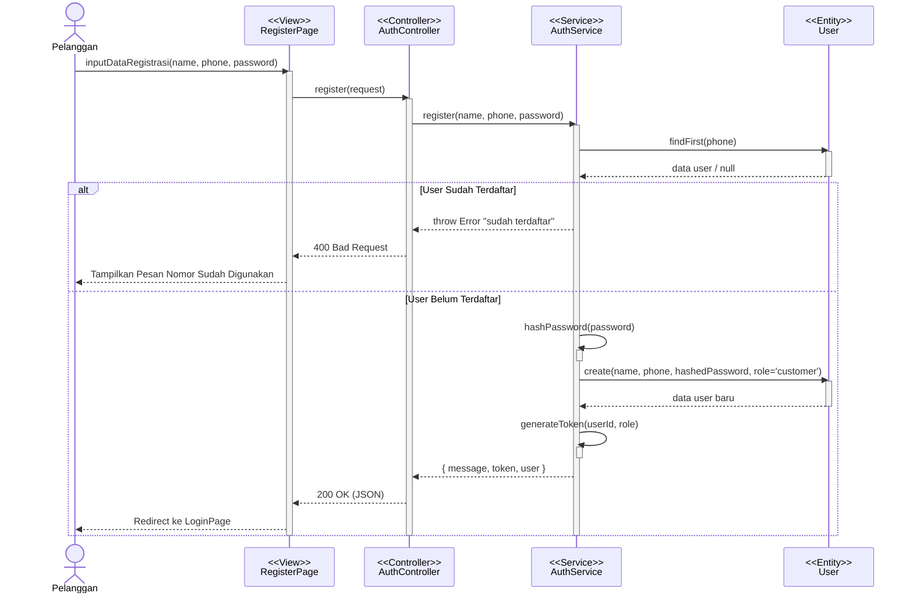

---

### 2. Sequence Diagram Login
Alur autentikasi pengguna (Pelanggan/Admin/Kasir). Setelah login, keranjang belanja guest dimigrasikan ke akun user.

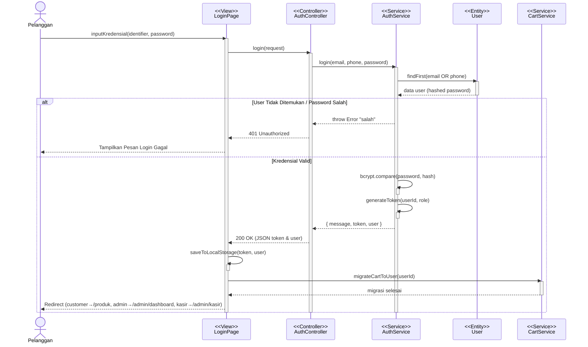

---

### 3. Sequence Diagram Lupa Password
Alur reset kata sandi. Sistem generate password baru lalu mengirimkannya via WhatsApp menggunakan API Fonnte.

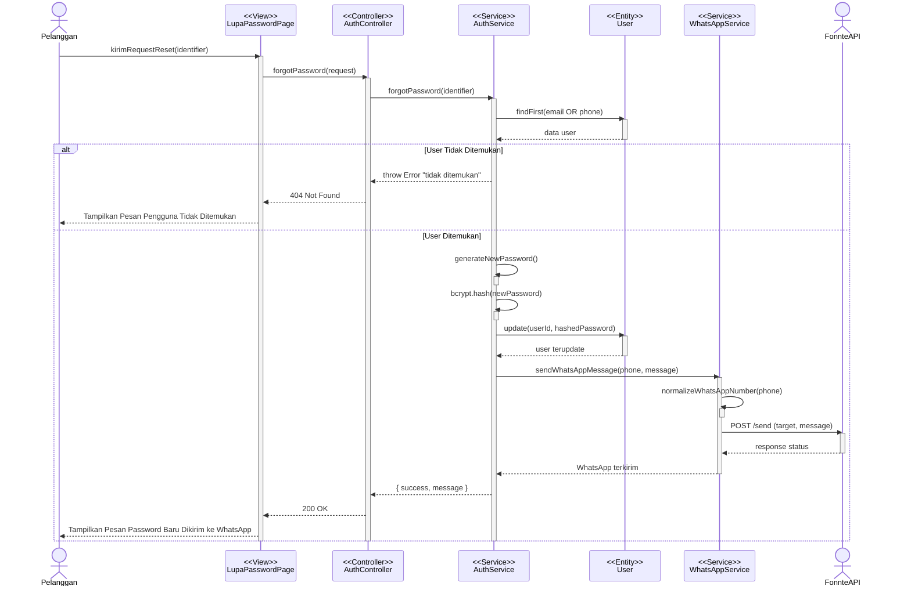

---

### 4. Sequence Diagram Kelola Profil
Alur modifikasi data profil pengguna (nama, email, nomor HP, password). Berlaku untuk semua role.

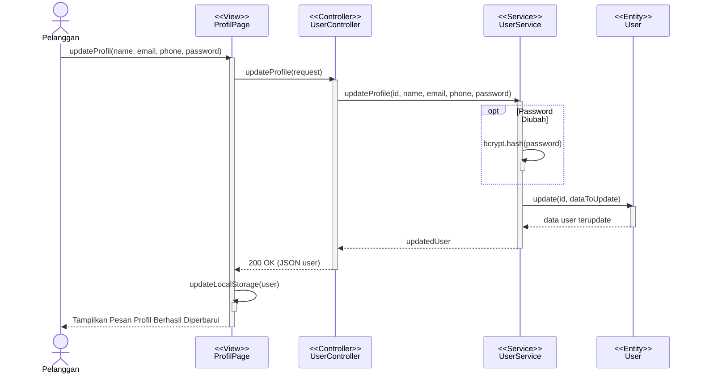

---

### 5. Sequence Diagram Browse Produk
Alur pelanggan menelusuri dan mencari katalog produk di halaman publik `/produk`.

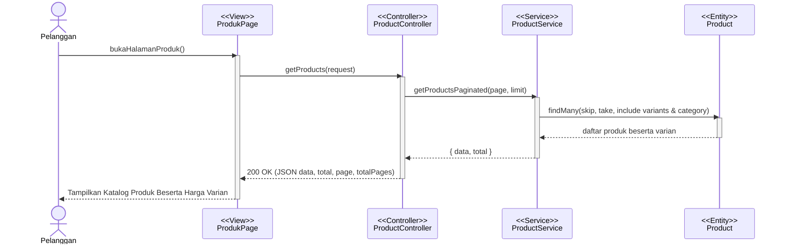

---

### 6. Sequence Diagram Tambah ke Keranjang
Alur penambahan produk ke keranjang belanja. Keranjang disimpan di LocalStorage client-side, dipisahkan per userId.

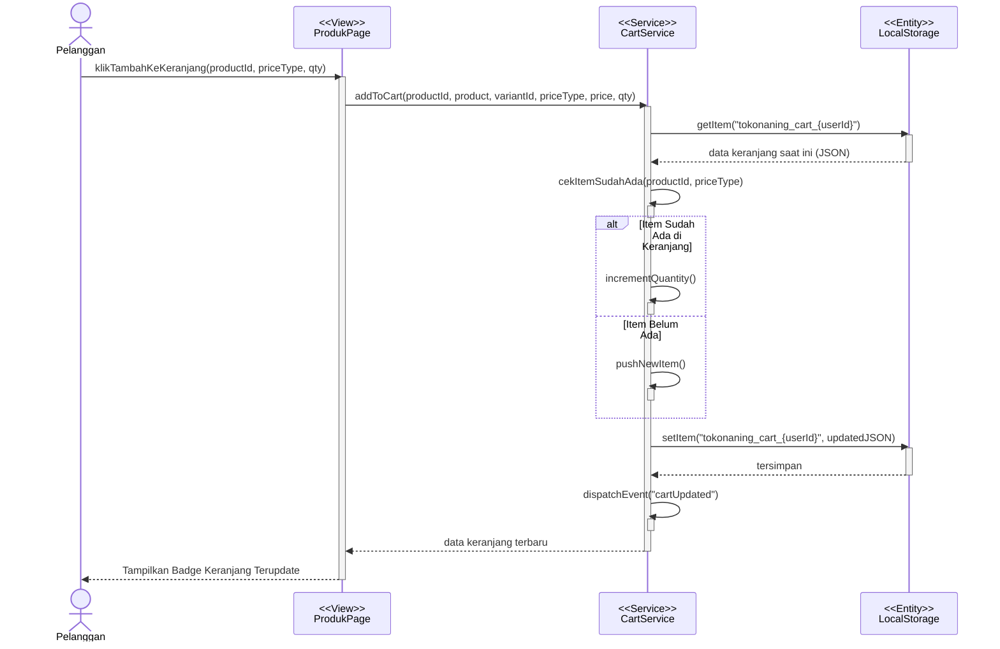

---

### 7. Sequence Diagram Pilih Metode Pengiriman
Alur pemilihan metode pengiriman (pickup/delivery) dan penghitungan jarak & ongkir saat delivery dipilih.

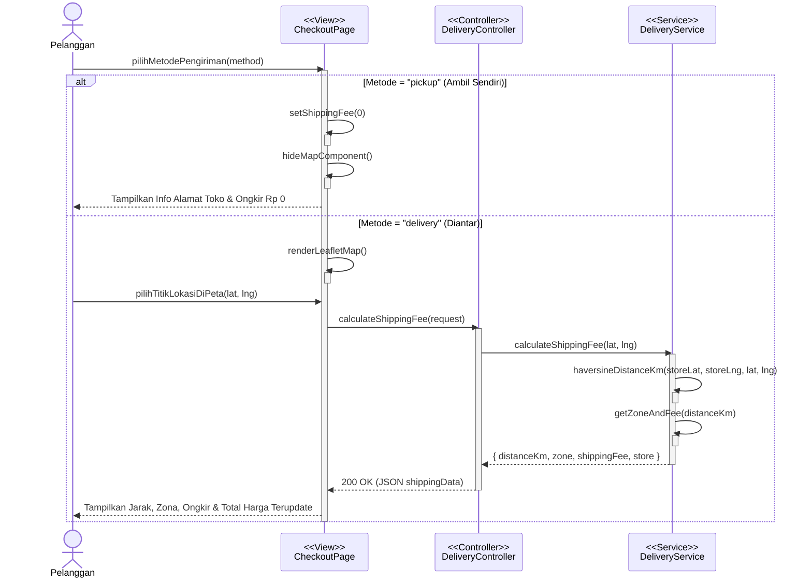

---

### 8. Sequence Diagram Hitung Jarak Lokasi
Alur penghitungan jarak menggunakan rumus Haversine antara koordinat toko dan pelanggan.

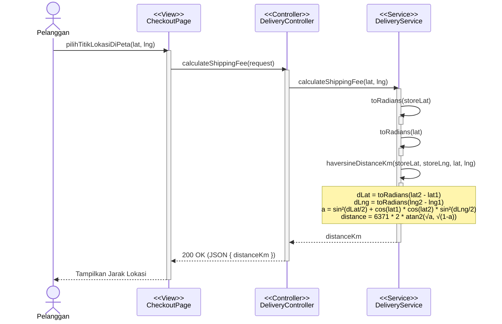

---

### 9. Sequence Diagram Hitung Ongkir
Alur penentuan tarif ongkos kirim berdasarkan zona jarak setelah jarak dihitung oleh Haversine.

```mermaid
sequenceDiagram
    actor Pelanggan
    participant View as <<View>><br/>CheckoutPage
    participant Controller as <<Controller>><br/>DeliveryController
    participant Service as <<Service>><br/>DeliveryService

    Pelanggan->>View: pilihTitikLokasiDiPeta(lat, lng)
    activate View
    View->>Controller: calculateShippingFee(request)
    activate Controller
    Controller->>Service: calculateShippingFee(lat, lng)
    activate Service

    Service->>Service: haversineDistanceKm(storeLat, storeLng, lat, lng)
    activate Service
    deactivate Service

    alt distanceKm > 10 km
        Service-->>Controller: throw Error "Lokasi di luar jangkauan (max 10 km)"
        deactivate Service
        Controller-->>View: 400 Bad Request
        deactivate Controller
        View-->>Pelanggan: Tampilkan Pesan Error Lokasi Terlalu Jauh
    else distanceKm <= 10 km
        Service->>Service: getZoneAndFee(distanceKm)
        activate Service
        Note over Service: <= 3km → Zona 1 (Rp 15.000)<br/><= 6km → Zona 2 (Rp 20.000)<br/><= 10km → Zona 3 (Rp 25.000)
        deactivate Service

        Service-->>Controller: { distanceKm, zone, shippingFee, store }
        deactivate Service
        Controller-->>View: 200 OK (JSON shippingData)
        deactivate Controller
        View-->>Pelanggan: Tampilkan Zona, Ongkir & Total Harga Terupdate
    end
    deactivate View
```

---

### 10. Sequence Diagram Checkout Pesanan
Alur pelanggan membuat pesanan dari halaman checkout. Stok dicek dan dikurangi, lalu notifikasi WhatsApp dikirim.

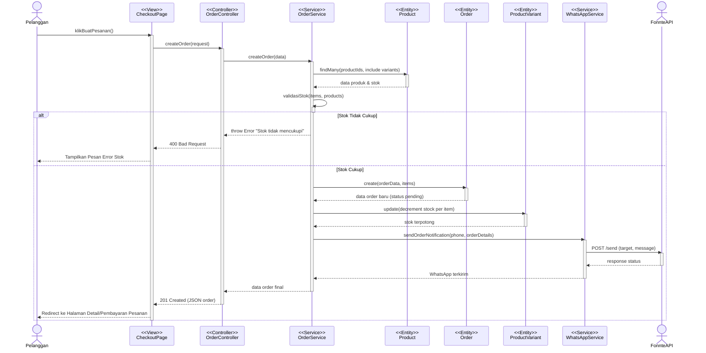

---

### 11. Sequence Diagram Generate Kode Pembayaran
Alur pembuatan kode pembayaran (VA number / QRIS) melalui integrasi API Pakasir saat pelanggan memilih metode non-tunai di halaman pembayaran.

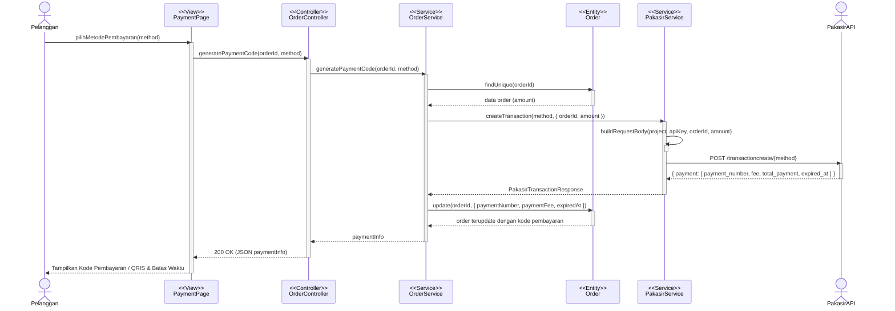

---

### 12. Sequence Diagram Melakukan Pembayaran
Alur pembayaran online berdasarkan peninjauan rincian tagihan, cek kedaluwarsa (pembatalan order jika habis), pemilihan metode digital (pencetakan kode bayar), transfer pembayaran oleh pelanggan, deteksi keberhasilan, dan pembaruan status menjadi lunas.

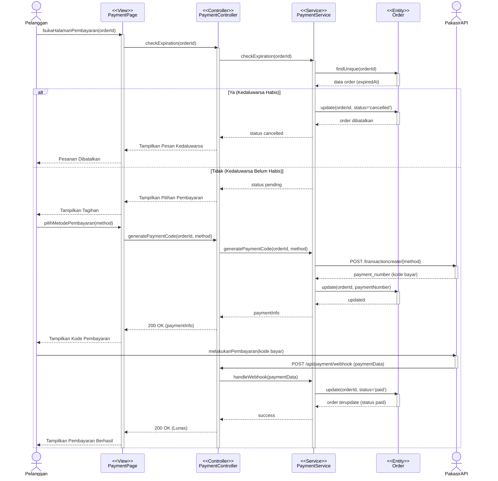

---

### 13. Sequence Diagram Lihat Riwayat Pesanan
Alur pelanggan melihat daftar riwayat pesanan miliknya di halaman `/pesanan`.

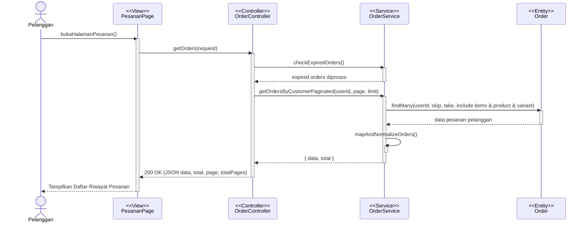

---

### 14. Sequence Diagram Kelola Produk
Alur Admin mengelola produk (tambah/edit/hapus) beserta varian harga. Hanya role `admin` yang bisa mengakses.

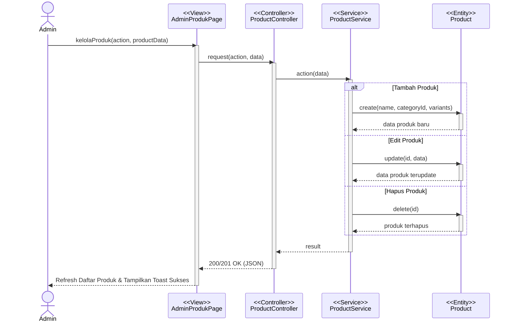

---

### 15. Sequence Diagram Kelola Pegawai
Alur Admin mengelola data pegawai yang terbagi menjadi akun kasir (tambah dengan password, reset password, hapus) dan data kurir (tambah tanpa password, aktifkan/nonaktifkan status) sesuai dengan tab manajemen yang dipilih.

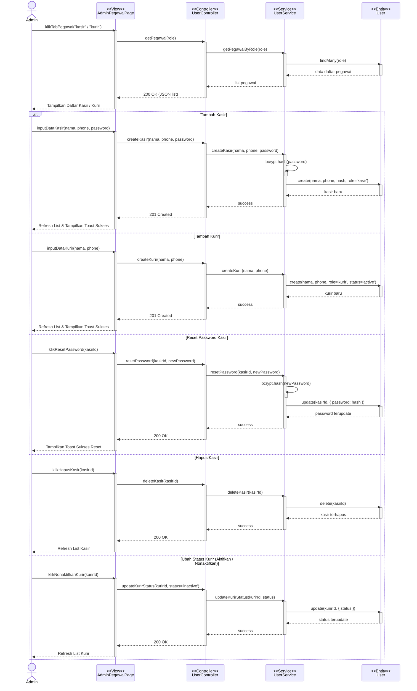

---

### 16. Sequence Diagram Lihat Laporan
Alur Admin melihat rekap laporan penjualan di halaman dashboard. Hanya role `admin` yang bisa mengakses.

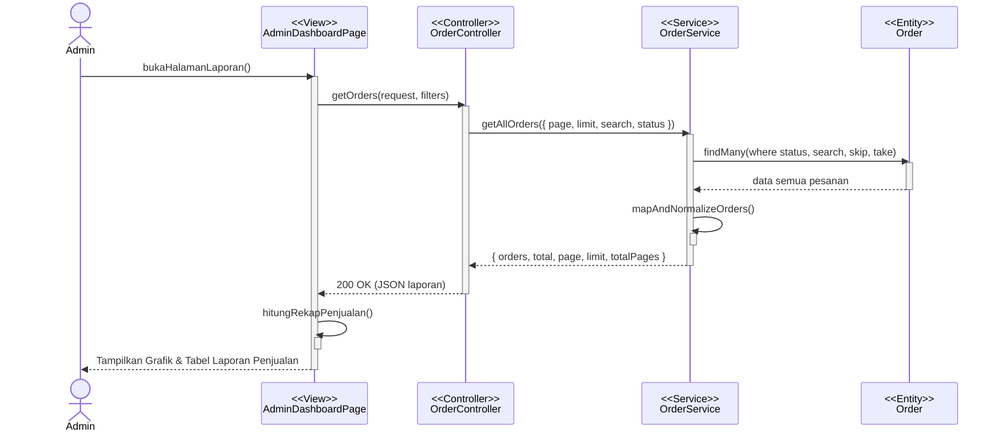

---

### 17. Sequence Diagram Kelola Pesanan
Alur Kasir membuat pesanan offline di kasir (POS), mencakup membuka halaman kasir, mencari produk (beserta penanganan notifikasi jika tidak ditemukan), menambah produk ke keranjang belanja, menginput data pelanggan, membuat pesanan baru, dan mengarahkan ke proses pembayaran.

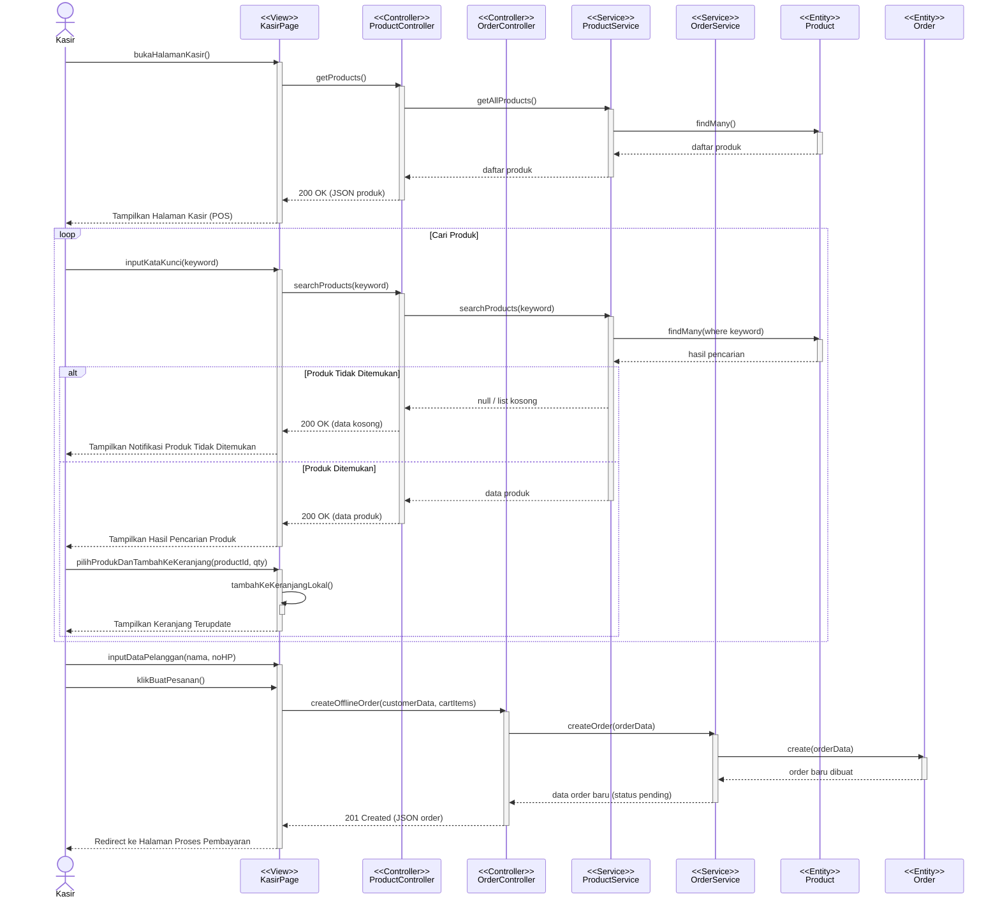

---

### 18. Sequence Diagram Proses Pembayaran (di Kasir)
Alur Kasir memproses pembayaran transaksi POS, mendukung metode tunai (input uang tunai, simpan transaksi, potong stok) dan digital (tampilkan QRIS/VA dari Pakasir, verifikasi pembayaran dengan alt sukses/gagal).

```mermaid
sequenceDiagram
    actor Kasir
    participant View as <<View>><br/>KasirPage
    participant Controller as <<Controller>><br/>CashierController
    participant Service as <<Service>><br/>CashierService
    participant OrderEntity as <<Entity>><br/>Order
    participant VariantEntity as <<Entity>><br/>ProductVariant
    actor PakasirAPI as PakasirAPI

    Kasir->>View: pilihMetodePembayaran(tunai / digital)
    activate View

    alt Tunai (Cash)
        Kasir->>View: inputPembayaranTunai(cashAmount)
        View->>Controller: prosesPembayaranTunai(orderId, cashAmount)
        activate Controller
        Controller->>Service: prosesPembayaranTunai(orderId, cashAmount)
        activate Service
        
        Service->>OrderEntity: update(orderId, status='paid', cashAmount)
        activate OrderEntity
        OrderEntity-->>Service: order terupdate (paid)
        deactivate OrderEntity

        Service->>VariantEntity: decrementStock(orderItems)
        activate VariantEntity
        VariantEntity-->>Service: stok terpotong
        deactivate VariantEntity

        Service-->>Controller: success (change / kembalian)
        deactivate Service
        Controller-->>View: 200 OK (JSON kembalian)
        deactivate Controller
        View-->>Kasir: Tampilkan Transaksi Berhasil & Kembalian

    else Digital (QRIS / VA)
        View->>Controller: generatePaymentCode(orderId, method='digital')
        activate Controller
        Controller->>Service: generatePaymentCode(orderId, method)
        activate Service
        Service->>PakasirAPI: POST /transactioncreate
        activate PakasirAPI
        PakasirAPI-->>Service: data QRIS / VA (payment_number, qr_string)
        deactivate PakasirAPI
        Service-->>Controller: paymentDetails
        deactivate Service
        Controller-->>View: 200 OK (JSON details)
        deactivate Controller
        View-->>Kasir: Tampilkan QRIS / VA di Layar

        %% Verifikasi Pembayaran
        Kasir->>View: klikVerifikasiPembayaran()
        View->>Controller: verifyPayment(orderId)
        activate Controller
        Controller->>Service: verifyPaymentStatus(orderId)
        activate Service
        Service->>PakasirAPI: GET /transactionstatus
        activate PakasirAPI
        PakasirAPI-->>Service: { status: 'PAID' / 'PENDING' }
        deactivate PakasirAPI

        alt Pembayaran Berhasil (Ya)
            Service->>OrderEntity: update(orderId, status='paid')
            activate OrderEntity
            OrderEntity-->>Service: order terupdate (paid)
            deactivate OrderEntity
            
            Service->>VariantEntity: decrementStock(orderItems)
            activate VariantEntity
            VariantEntity-->>Service: stok terpotong
            deactivate VariantEntity
            
            Service-->>Controller: success
            deactivate Service
            Controller-->>View: 200 OK (PAID)
            deactivate Controller
            View-->>Kasir: Tampilkan Transaksi Berhasil (Lunas)
        else Pembayaran Gagal (Tidak)
            Service-->>Controller: failure (PENDING/EXPIRED)
            deactivate Service
            Controller-->>View: 400 Bad Request
            deactivate Controller
            View-->>Kasir: Tampilkan Notifikasi Pembayaran Gagal
        end
    end
    deactivate View
```

---

### 19. Sequence Diagram Cetak Struk
Alur Kasir mencetak struk belanja fisik melalui printer thermal, mencakup pengambilan data pesanan, pemformatan nota thermal, pengiriman perintah cetak, dan penanganan kondisi berdasarkan status printer (menyala untuk mencetak vs mati untuk memunculkan notifikasi tidak aktif).

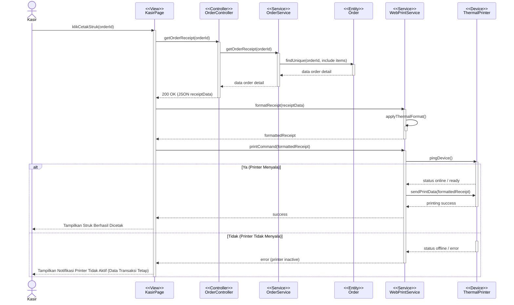

---

### 20. Sequence Diagram Kelola Pesanan Online
Alur Kasir memproses pesanan online, meliputi pemfilteran daftar pesanan online, penugasan kurir pengantar, serta pengiriman notifikasi pengiriman WhatsApp secara paralel ke Pelanggan dan Kurir.

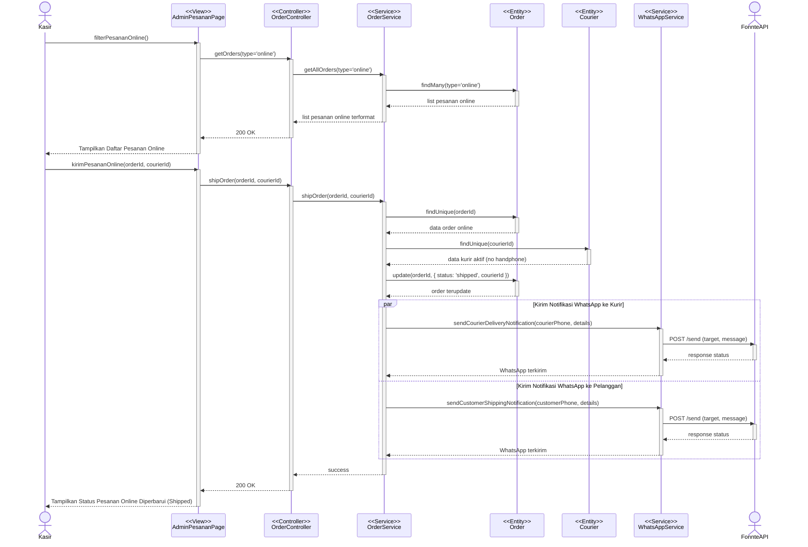

---

### 21. Sequence Diagram Kirim WhatsApp
Alur pengiriman pesan WhatsApp melalui integrasi API Fonnte. Digunakan oleh berbagai fitur: notifikasi pesanan, struk, info pengiriman, reset password.

```mermaid
sequenceDiagram
    participant Caller as <<Service>><br/>CallerService
    participant WA as <<Service>><br/>WhatsAppService
    actor Fonnte as FonnteAPI
    actor Penerima

    Caller->>WA: sendWhatsAppMessage(phone, message)
    activate WA

    WA->>WA: normalizeWhatsAppNumber(phone)
    activate WA
    Note over WA: Hapus karakter non-digit<br/>08xx → 628xx<br/>8xx → 628xx<br/>Validasi panjang minimal 10 digit
    deactivate WA

    WA->>Fonnte: POST /send { target: normalizedPhone, message }
    activate Fonnte
    Fonnte->>Penerima: Kirim Pesan WhatsApp
    Fonnte-->>WA: { status: true/false, reason }
    deactivate Fonnte

    alt Fonnte Gagal (status: false)
        WA-->>Caller: throw Error (reason)
    else Fonnte Berhasil (status: true)
        WA-->>Caller: response data
    end
    deactivate WA
```
